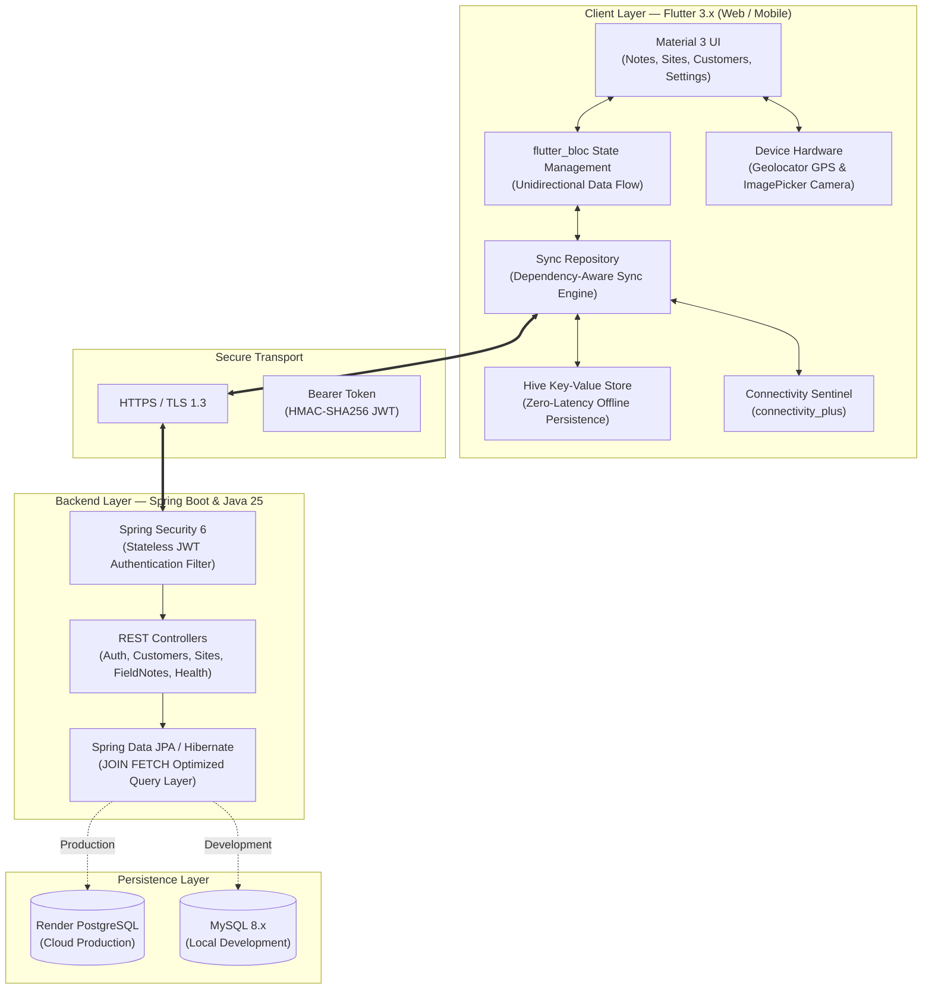

# 📝 Field Notes — Industrial Offline-First Field Service & Inspection Platform

[](https://flutter.dev)
[](https://dart.dev)
[](https://openjdk.org/)
[](https://spring.io/projects/spring-boot)
[](https://spring.io/projects/spring-security)
[](https://www.postgresql.org/)
[](https://www.mysql.com/)
[](https://pub.dev/packages/hive)
[](https://fieldnotes-app-rho.vercel.app)
[](https://fieldnotes-api-2sp0.onrender.com)
[](LICENSE)

An enterprise-grade, offline-first field service and site inspection management platform engineered for structural engineers, utility inspectors, and field technicians. Built to operate with 100% reliability in remote environments with intermittent or zero internet connectivity, ensuring zero data loss and automated multi-tier cloud synchronization.

---

## 🌐 Live Demonstrations & Cloud Endpoints

The full system is deployed, containerized, and publicly accessible:

| Component | Target URL | Status & Description |
|---|---|---|
| **Live Web Application** | [https://fieldnotes-app-rho.vercel.app](https://fieldnotes-app-rho.vercel.app) | Production Single-Page App running Flutter Web on Vercel Edge Network |
| **Production REST API** | [https://fieldnotes-api-2sp0.onrender.com](https://fieldnotes-api-2sp0.onrender.com) | Spring Boot REST API container deployed on Render with PostgreSQL |
| **API Health Sentinel** | [https://fieldnotes-api-2sp0.onrender.com/api/health](https://fieldnotes-api-2sp0.onrender.com/api/health) | Live JSON health check endpoint |

> **Note on Free-Tier Sleep Cycle**: Render services sleep after inactivity. If making the first request after an idle period, please allow ~40–50 seconds for container spin-up.

### 🔑 Instant 1-Click Demo Access
A pre-seeded demonstration account is available directly on the web login screen with a **1-Click "Demo Login"** button:

* **Email:** `demo@test.com`
* **Password:** `demo123`

The demo profile comes pre-populated with realistic industrial data across civil engineering, renewable energy, and municipal infrastructure projects (e.g., foundation integrity tests, high-voltage PV inverter diagnostics, expansion joint sealant inspections).

---

## 🏗️ System Architecture & Data Flow



---

## 🔄 Offline-First Synchronization Engine

Field inspectors frequently operate in sub-basements, rural corridors, tunnels, or high-RF industrial facilities where cellular connections drop out entirely. **Field Notes** is engineered from the ground up as an **Offline-First** system:

```
┌────────────────────────────────────────────────────────────────────────┐
│                      OFFLINE-FIRST ENGINE LIFECYCLE                    │
└────────────────────────────────────────────────────────────────────────┘

  [Technician Creates Note]
             │
             ▼
  ┌──────────────────────┐
  │ Local Hive Storage   │ ──► Generates Client-Side UUID (localId)
  │ (dirty = true)       │ ──► Immediately renders in UI with zero delay
  └──────────────────────┘
             │
      [Network Detected]
             │
             ▼
  ┌─────────────────────────────────────────────────────────────────────┐
  │ Cascading Parent-to-Child Sync Queue:                               │
  │   1. Push Dirty Customers ──► Assign serverId (e.g., #101)          │
  │   2. Push Dirty Sites     ──► Map customerId = 101, receive #202    │
  │   3. Push Dirty Notes     ──► Map siteId = 202, receive #303        │
  └─────────────────────────────────────────────────────────────────────┘
             │
             ▼
  ┌──────────────────────┐
  │ Server Pull & Merge  │ ──► Reconciles cloud state without overwriting
  │ (dirty = false)      │     uncommitted local changes
  └──────────────────────┘
```

### Key Synchronization Mechanics:
1. **Dual-Identifier Architecture:** Every entity possesses a client-generated UUID (`localId`) and an optional database primary key (`serverId`). Relations are tracked client-side via local IDs, allowing infinite nested entities to be created offline without waiting for server-assigned auto-increments.
2. **Topological Sync Order (Parent-to-Child):**
   * **Stage 1 (Customers):** Sync pending customer inserts/updates/deletions. Server returns assigned database IDs.
   * **Stage 2 (Sites):** Resolve parent customer's server ID, then push sites with valid `customerId` foreign keys.
   * **Stage 3 (Field Notes):** Resolve parent site's server ID, then push field notes with verified `siteId` foreign keys.
3. **Dirty-Flag State Machine:** All mutations write directly to local Hive boxes with `dirty = true`. Once the server responds with HTTP 200/201, the entity is updated with `dirty = false` and stamped with the server ID.
4. **Soft Deletes Offline:** Items marked for deletion offline receive `deleted = true, dirty = true`. During sync, the queue dispatches `DELETE /api/{entity}/{serverId}` calls and safely purges the local record upon confirmation.
5. **Conflict-Free Re-alignment on Pull:** When pulling down cloud data (or on a clean device install), the engine checks `if (existing != null && existing.dirty) continue;`, guaranteeing that unpushed field notes are never overwritten by incoming server snapshots.

---

## 🎨 Frontend Architecture & Features (Flutter 3.x)

The frontend is built with Flutter 3.x adhering to modern Flutter best practices and clean architecture patterns:

### 1. BLoC State Management Pattern (`flutter_bloc`)
* **Separation of Concerns:** Business logic is decoupled from presentation widgets into dedicated BLoCs:
  * `AuthBloc`: Authentication lifecycle, JWT token persistence, and login/register states.
  * `CustomerBloc`: Client management, offline filtering, and reactive CRUD.
  * `SiteBloc`: Project job-site relations tied to parent customers.
  * `NoteBloc`: Note creation, GPS tagging, photo evidence, query filtering, and cloud synchronization.
  * `SettingsBloc`: Persists user preferences (e.g., default note status on creation) using `SharedPreferences`.

### 2. Material 3 Design & Visual Status Coding
Field Notes features a polished Material 3 design system with vibrant, high-contrast status chips designed for rapid glanceability under bright sunlight or dark mechanical rooms:

| Status | Color Representation | Hex Code | Purpose & Context |
|---|---|---|---|
| **OPEN** | 🟡 **Amber** | `#F59E0B` | Unassigned or newly logged site anomalies needing review |
| **IN_PROGRESS** | 🔵 **Sky Blue** | `#0284C7` | Active investigation, mechanical repairs, or testing in progress |
| **DONE** | 🟢 **Emerald** | `#10B981` | Certified completed work orders, sign-offs, and closed tickets |

### 3. Integrated Hardware Capabilities
* **Hardware GPS Coordinate Capture:** Integrates `geolocator` with runtime location permissions. A single tap queries the device GNSS module and populates decimal latitude/longitude coordinates (e.g., `30.2672 N, 97.7431 W`) into the note.
* **Photo Evidence Capture:** Uses `image_picker` to capture camera photos or pick from the local gallery. On mobile, images are persisted locally; on Web, photos are automatically converted into Base64 JPEG data-URLs (`data:image/jpeg;base64,...`) for seamless cross-platform display and cloud sync.
* **Real-time Querying & Filtering:** Instant client-side search across title, description, location, site name, and customer name, with dynamic multi-status chip filtering.

---

## ⚙️ Backend Architecture & Engineering (Spring Boot 3.x & Java 25)

The backend is built with Spring Boot running on Java 25, structured for security, scalability, and relational integrity.

### 1. Relational Domain Hierarchy
The domain enforces clean normalization and multi-tenant security:

```
 User (1)
   └── Customer (N)
         └── Site (N)
               └── Field Note (N)
```

* **Multi-Tenant Isolation:** Every record belongs to an authenticated `User`. Controllers extract the `userId` directly from the authenticated JWT principal (`(Long) auth.getPrincipal()`), making cross-tenant data leaks impossible.
* **Relational Normalization:** Sites link to Customers; Field Notes link to Sites. Entity names are retrieved relationally rather than stored as duplicated denormalized text.

### 2. N+1 Query Problem Elimination (`JOIN FETCH`)
Default JPA relationships can trigger catastrophic N+1 database queries when fetching hierarchical data. Field Notes resolves this with custom JPQL queries using explicit `JOIN FETCH` clauses:

```java
// FieldNoteRepository.java
@Query("SELECT n FROM FieldNote n " +
       "JOIN FETCH n.site s " +
       "JOIN FETCH s.customer " +
       "WHERE n.user.id = :userId " +
       "ORDER BY n.updatedAt DESC")
List<FieldNote> findAllByUserWithRelations(@Param("userId") Long userId);
```

This single query loads all field notes along with their associated sites and parent customers in **one efficient SQL join**, eliminating hundreds of redundant round trips.

### 3. Stateless Security Architecture
* **Spring Security 6+ Filter Chain:** Complete stateless session configuration (`SessionCreationPolicy.STATELESS`).
* **JWT Authentication:** HMAC-SHA256 signatures with 24-hour expiration (`io.jsonwebtoken:jjwt 0.12.6`).
* **BCrypt Hashing:** Passwords hashed with BCrypt prior to database persistence.
* **CORS Management:** Configurable allowed origins via `CORS_ALLOWED_ORIGINS` to securely permit requests from Vercel deployments and local development hosts.

### 4. Dual-Database Support
* **Cloud Production:** PostgreSQL 16+ on Render via JDBC URL configuration (`JDBC_DATABASE_URL`).
* **Local Development:** MySQL 8.x / MariaDB with automatic database schema generation (`createDatabaseIfNotExist=true`).

---

## 📡 REST API Reference

All protected endpoints require an `Authorization: Bearer <token>` header.

### 🔐 Authentication & Health

| Method | Endpoint | Description | Auth Required |
|---|---|---|:---:|
| `POST` | `/api/auth/register` | Register new user account | ❌ |
| `POST` | `/api/auth/login` | Authenticate with credentials and receive JWT | ❌ |
| `GET` | `/api/health` | Container health check status | ❌ |

#### Example Login Request:
```bash
curl -X POST https://fieldnotes-api-2sp0.onrender.com/api/auth/login \
  -H "Content-Type: application/json" \
  -d '{"email":"demo@test.com","password":"demo123"}'
```

#### Example Login Response:
```json
{
  "token": "eyJhbGciOiJIUzI1NiJ9...",
  "userId": 1,
  "name": "Alex Vance (Lead Field Engineer)",
  "email": "demo@test.com"
}
```

---

### 🏢 Customers (`/api/customers`)

| Method | Endpoint | Description |
|---|---|---|
| `GET` | `/api/customers` | List all customers owned by the authenticated user |
| `POST` | `/api/customers` | Create a new customer record |
| `GET` | `/api/customers/{id}` | Retrieve single customer details |
| `PUT` | `/api/customers/{id}` | Update customer name or contact information |
| `DELETE` | `/api/customers/{id}` | Delete customer (cascades to associated sites and notes) |

---

### 📍 Sites (`/api/sites`)

| Method | Endpoint | Description |
|---|---|---|
| `GET` | `/api/sites` | List all sites (supports `?customerId={id}` filter) |
| `POST` | `/api/sites` | Create a site linked to a valid `customerId` |
| `GET` | `/api/sites/{id}` | Retrieve single site with parent customer details |
| `PUT` | `/api/sites/{id}` | Update site name, address, or parent customer |
| `DELETE` | `/api/sites/{id}` | Delete site (cascades to child notes) |

---

### 📝 Field Notes (`/api/notes`)

| Method | Endpoint | Description |
|---|---|---|
| `GET` | `/api/notes` | List notes with optional filters (`?siteId=`, `?status=`, `?q=`) |
| `POST` | `/api/notes` | Create a new field note linked to a `siteId` |
| `GET` | `/api/notes/{id}` | Retrieve single field note with site and customer graph |
| `PUT` | `/api/notes/{id}` | Update title, description, status, location, or photo |
| `DELETE` | `/api/notes/{id}` | Delete field note |

#### Example Note Creation Payload:
```json
{
  "siteId": 2,
  "title": "Expansion Joint Sealant Replacement",
  "description": "High-cycle thermal expansion causing micro-fissures along transverse joint J-03. Polyurethane backer rod intact.",
  "location": "East Span Pier 7 (30.2710 N, 97.7390 W)",
  "dateTime": "2026-10-14T18:30:00Z",
  "status": "OPEN",
  "photoPath": "data:image/jpeg;base64,/9j/4AAQSkZJRg..."
}
```

---

## 📁 Repository Structure

```
Field Notes/
├── .github/
│   └── workflows/
│       └── vercel-web.yml         # Automated GitHub Actions CI/CD pipeline for Vercel
├── app/                           # Flutter 3.x Client Application
│   ├── lib/
│   │   ├── blocs/                 # flutter_bloc State Machines
│   │   │   ├── auth/              # AuthBloc (login, registration, tokens)
│   │   │   ├── customers/         # CustomerBloc
│   │   │   ├── notes/             # NoteBloc (CRUD, filtering, search)
│   │   │   ├── settings/          # SettingsBloc (preferences persistence)
│   │   │   └── sites/             # SiteBloc
│   │   ├── core/                  # App configuration & runtime environment settings
│   │   ├── data/
│   │   │   ├── local/             # Hive Key-Value persistence & LocalStore
│   │   │   ├── models/            # Customer, Site, FieldNote data entities
│   │   │   ├── remote/            # HTTP ApiService & REST client
│   │   │   └── sync_repository.dart # Dependency-aware sync queue & offline engine
│   │   ├── ui/                    # Material 3 responsive UI screens
│   │   └── main.dart              # Application bootstrap & dependency injection
│   ├── test/                      # Flutter widget and unit tests
│   └── pubspec.yaml               # Dart dependencies & platform configuration
├── backend/                       # Spring Boot 3.x / Java 25 REST Backend
│   ├── src/
│   │   ├── main/
│   │   │   ├── java/com/fieldnotes/api/
│   │   │   │   ├── config/        # Database configuration & realistic DataSeeder
│   │   │   │   ├── controller/    # Auth, Customer, Site, Note, Health controllers
│   │   │   │   ├── dto/           # Strongly-typed Java Record DTOs
│   │   │   │   ├── entity/        # JPA Hibernate entities (User, Customer, Site, Note)
│   │   │   │   ├── repository/    # Spring Data JPA repositories with JOIN FETCH
│   │   │   │   └── security/      # JWT Filter, JwtUtil, SecurityConfig, CorsConfig
│   │   │   └── resources/
│   │   │       └── application.properties # Multi-environment configuration
│   │   └── test/                  # Spring Boot integration and context tests
│   ├── Dockerfile                 # Multi-stage Java 25 production container build
│   ├── render.yaml                # Infrastructure-as-code blueprint for Render
│   └── pom.xml                    # Maven dependencies and build definition
└── README.md                      # Comprehensive project documentation
```

---

## 💻 Local Development & Setup

### Prerequisites
* **Java Development Kit (JDK):** Version 25 (or compatible 21+ LTS)
* **Maven:** Version 3.9+ (or use included `mvnw`)
* **Flutter SDK:** Version 3.24+ (Channel stable)
* **Database:** MySQL 8.x / MariaDB running locally on port 3306 (e.g., via XAMPP, Docker, or standalone service)

---

### 1. Backend Setup (Spring Boot + MySQL)

1. **Configure Database:**
   Ensure MySQL is running on `localhost:3306`. The application will automatically create the `fieldnotes` database if it doesn't already exist.
   Default credentials in `backend/src/main/resources/application.properties`:
   ```properties
   spring.datasource.url=jdbc:mysql://localhost:3306/fieldnotes?createDatabaseIfNotExist=true&useSSL=false&allowPublicKeyRetrieval=true&serverTimezone=UTC
   spring.datasource.username=root
   spring.datasource.password=
   ```

2. **Run Backend Service:**
   ```bash
   cd backend
   mvn spring-boot:run
   ```
   The backend will start on `http://localhost:8080`.
   * On startup, the built-in `DataSeeder` automatically verifies or creates the demo account (`demo@test.com` / `demo123`) and populates realistic demo customers, sites, and notes.

3. **Verify API Health:**
   ```bash
   curl http://localhost:8080/api/health
   # Response: {"status":"UP","service":"fieldnotes-api"}
   ```

---

### 2. Frontend Setup (Flutter Mobile & Web)

1. **Install Dependencies:**
   ```bash
   cd app
   flutter pub get
   ```

2. **Run on Chrome (Web):**
   ```bash
   flutter run -d chrome --dart-define=API_BASE_URL=http://localhost:8080
   ```

3. **Run on Android Emulator or Physical Device:**
   ```bash
   # For Android Emulator, use 10.0.2.2 to access host machine's localhost:
   flutter run -d android --dart-define=API_BASE_URL=http://10.0.2.2:8080
   ```

4. **Run Against Live Production Backend:**
   ```bash
   flutter run -d chrome --dart-define=API_BASE_URL=https://fieldnotes-api-2sp0.onrender.com
   ```

---

## 🧪 Testing & Quality Assurance

Both frontend and backend are equipped with automated test suites verifying model integrity, relational mapping, and API context:

### Frontend Unit & Relation Tests:
```bash
cd app
# Run static code analysis
flutter analyze

# Execute test suite
flutter test
```
The Flutter test suite verifies:
* Customer JSON/Map bidirectional serialization round-tripping.
* Site foreign key retention using client-side `localId`.
* FieldNote status state validation and parent association.

### Backend Context & Spring Tests:
```bash
cd backend
mvn test
```
The Spring test suite verifies:
* Spring application context initialization.
* Hibernate entity mappings and relational constraints.
* JPA repository query syntax and security configuration loading.

---

## 🚀 CI/CD & Deployment Architecture

### 1. Web Deployment (Vercel + GitHub Actions)
The frontend is continuously integrated and deployed to Vercel via `.github/workflows/vercel-web.yml`:
1. **Trigger:** Every push to `main` touching `app/**`.
2. **Analysis & Test:** Executes `flutter analyze` and `flutter test`.
3. **Compilation:** Compiles production web bundle with embedded production API definition:
   ```bash
   flutter build web --release --dart-define=API_BASE_URL="https://fieldnotes-api-2sp0.onrender.com"
   ```
4. **Deployment:** Deploys static build artifacts directly to Vercel Edge CDN with zero downtime.

### 2. API Deployment (Render Cloud + Docker)
The backend is packaged using a multi-stage Dockerfile (`backend/Dockerfile`):
1. **Build Stage:** Maven + OpenJDK compiles and packages the Spring Boot executable JAR.
2. **Runtime Stage:** Slim Alpine/Eclipse-Temurin JRE image runs the compiled JAR, respecting dynamic `$PORT` environment variables provided by Render.
3. **Database:** Render-managed PostgreSQL database connected via SSL JDBC URL (`JDBC_DATABASE_URL`).

---

## 👤 Author & Ownership

Designed, engineered, and maintained with ❤️ by:

* **Author:** Naimur Rahman Nahid ([@naimur-rooted](https://github.com/naimur-rooted))
* **Email:** [nahid018536@gmail.com](mailto:nahid018536@gmail.com)
* **GitHub:** [https://github.com/naimur-rooted](https://github.com/naimur-rooted)

---

## 📄 License

This project is licensed under the **MIT License** — see the [LICENSE](LICENSE) file for full details. You are free to modify, distribute, and build upon this software for commercial and private use.
